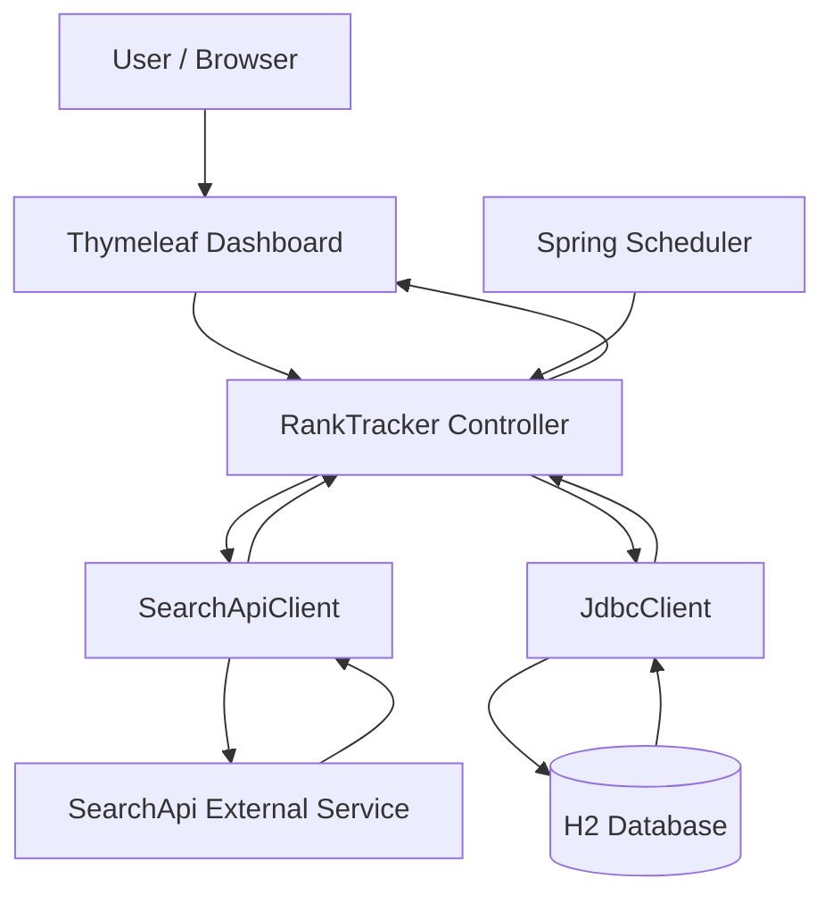

# RankTracker – Google Keyword Rank Tracking System

A Java and Spring Boot application that tracks a website's Google search ranking for specific keywords, stores daily ranking history, and visualizes ranking changes through an interactive dashboard.

## Overview

RankTracker allows users to monitor how their website performs in Google search results for selected keywords.

Users can add keywords, fetch their current search positions using SearchApi, store historical ranking data, and monitor ranking improvements or drops over time.

The application also automates daily ranking checks and prevents duplicate API calls for the same keyword on the same day.

## Features

- **Keyword Tracking:** Add keywords and immediately check their Google search ranking.
- **Google Search Integration:** Fetch search results using the SearchApi Google Rank Tracking engine.
- **Domain Matching:** Identify the configured website within the returned search results.
- **Ranking History:** Store daily keyword positions in an H2 database.
- **Duplicate Prevention:** Prevent repeated checks for the same keyword on the same day.
- **Automated Scheduling:** Run daily ranking checks using Spring's scheduling support.
- **Ranking Change Detection:** Compare the latest ranking with the previous recorded position.
- **Smart Alerts:** Identify keywords entering the top 10, dropping out of the top 100, or moving at least five positions.
- **Interactive Dashboard:** Display keyword rankings, changes, alerts, and historical trends.
- **Persistent Storage:** Maintain ranking history using file-based H2 storage.

## Dashboard

The dashboard provides an overview of tracked keywords, their current positions, ranking changes, and historical performance.

<!-- Add your dashboard screenshot at docs/images/dashboard.png -->


## Technology Stack

| Technology | Purpose |
|---|---|
| Java 21 | Backend programming language |
| Spring Boot 4.1.3 | Application framework |
| Spring MVC | Web request handling |
| Spring JDBC | Database access |
| JdbcClient | SQL execution and result mapping |
| H2 Database | Persistent local database |
| SearchApi | Google search ranking data |
| Thymeleaf | Server-side HTML rendering |
| Chart.js | Historical ranking visualization |
| Maven | Dependency and build management |
| SLF4J | Application logging |

## Architecture

RankTracker uses a Spring-managed MVC architecture with separate responsibilities for web handling, external API integration, and database operations.

### High-Level Architecture



### Component Responsibilities

**1. RanktrackerApplication.java**

- Main Spring Boot application entry point.
- Enables scheduled task execution using `@EnableScheduling`.
- Starts the Spring application context.

**2. RankTracker.java**

Acts as the application's main controller and ranking workflow coordinator.

Responsibilities:

- Accept keyword submissions.
- Trigger immediate ranking checks.
- Retrieve ranking history from the database.
- Calculate ranking changes.
- Generate ranking alerts.
- Prepare data for the dashboard.
- Execute scheduled daily checks.

**3. SearchApiClient.java**

Responsible for communication with the external SearchApi service.

Responsibilities:

- Configure Spring's `RestClient`.
- Send Google rank-tracking requests.
- Pass the keyword as a query parameter.
- Read the organic search results.
- Map the response into Java records.

**4. JdbcClient**

Spring JDBC's `JdbcClient` is used for database operations.

It handles:

- Checking whether a keyword has already been checked today.
- Inserting new ranking records.
- Retrieving historical rankings.
- Fetching distinct tracked keywords.

**5. H2 Database**

Stores keyword ranking history.

The application uses file-based H2 storage to preserve records across normal application restarts.

**6. dashboard.html**

Thymeleaf template responsible for rendering:

- Website domain.
- Keyword input form.
- Ranking table.
- Ranking alerts.
- Historical ranking chart.

**7. Chart.js**

Displays historical ranking data using a line chart, with ranking position 1 placed at the top of the vertical axis.

## Application Workflow

### 1. Adding a Keyword

The user enters a keyword through the dashboard.

The form submits a POST request to:

`POST /keywords`

The controller receives the keyword and triggers an immediate ranking check.

### 2. Fetching Google Search Results

`SearchApiClient` uses Spring's `RestClient` to communicate with SearchApi.

The request includes:

- Search engine: `google_rank_tracking`
- Query: User-provided keyword
- API authentication: Environment-based API key

The client reads the organic search results and maps them into Java records.

### 3. Identifying Website Position

The application searches the returned results for the configured domain.

It supports both exact domain matches and subdomains.

For example:

- `embarkx.com`
- `www.embarkx.com`

If the domain is found, its ranking position is recorded.

If the domain is not found in the returned results, the position is stored as `NULL`, representing a position outside the tracked top 100.

### 4. Preventing Duplicate API Calls

Before calling SearchApi, the application checks whether a record already exists for the same keyword and date.

```sql
SELECT COUNT(*)
FROM ranking
WHERE keyword = ?
AND checked_on = ?
```

If a record exists, the application skips the API request.

This prevents unnecessary API usage and avoids duplicate daily records.

### 5. Storing Ranking History

A successful ranking check is saved using:

```sql
INSERT INTO ranking
(keyword, position, checked_on)
VALUES (?, ?, ?)
```

The database uses a composite primary key consisting of:

- `keyword`
- `checked_on`

This enforces one stored record per keyword per day.

### 6. Ranking Change Calculation

The application compares the latest recorded position with the previous recorded position.

Examples:

- Previous: #12, Current: #8 → Improved by 4 positions.
- Previous: #5, Current: #9 → Dropped by 4 positions.
- Previous: #20, Current: #12 → Improved by 8 positions.

A lower numerical ranking position indicates better performance.

### 7. Ranking Alerts

The application generates alerts for specific ranking events:

| Condition | Alert |
|---|---|
| Previous position above 10 and current position 10 or better | Entered the top 10 |
| Current position is NULL | Dropped out of the top 100 |
| Absolute ranking movement is at least 5 positions | Significant ranking movement |

### 8. Historical Visualization

The controller prepares:

- `domain`: Configured website domain.
- `rows`: Latest ranking information and alerts.
- `days`: Distinct dates of recorded ranking checks.
- `lines`: Ranking history grouped by keyword.

These values are passed to Thymeleaf and visualized using Chart.js.

## Database Design

The application uses an H2 database with the following table.

### Ranking Table

```sql
CREATE TABLE IF NOT EXISTS ranking (
    keyword    VARCHAR(255) NOT NULL,
    checked_on DATE NOT NULL,
    position   INT,
    PRIMARY KEY (keyword, checked_on)
);
```

### Schema Explanation

| Column | Data Type | Description |
|---|---|---|
| keyword | VARCHAR(255) | Tracked search keyword |
| checked_on | DATE | Date of ranking check |
| position | INT | Google search position, or NULL if outside the top 100 |

**Database design decision:** The composite primary key prevents duplicate records for the same keyword on the same date.

## Automated Scheduling

RankTracker uses Spring's `@Scheduled` annotation to execute daily ranking checks.

Default configuration:

```properties
tracker.check-cron=0 0 6 * * *
```

This schedules the ranking check at 6:00 AM according to the JVM's configured timezone.

The `checkAll()` method:

1. Retrieves distinct keywords from the database.
2. Iterates through the tracked keywords.
3. Calls the ranking check method.
4. Skips keywords already checked on the current date.
5. Stores new ranking results.

The application also triggers `checkAll()` after startup using `ApplicationReadyEvent`.

**Important:** The application must be running for scheduled checks to execute. If it is stopped at the scheduled time, the startup check provides another opportunity to process existing keywords.

## Project Structure

```text
ranktracker/
│
├── src/
│   ├── main/
│   │   ├── java/
│   │   │   └── com/demo/ranktracker/
│   │   │       ├── RanktrackerApplication.java
│   │   │       ├── RankTracker.java
│   │   │       └── SearchApiClient.java
│   │   │
│   │   └── resources/
│   │       ├── static/
│   │       │   └── css/
│   │       │       └── style.css
│   │       │
│   │       ├── templates/
│   │       │   └── dashboard.html
│   │       │
│   │       ├── application.properties
│   │       ├── application-demo.properties
│   │       ├── application-dev.properties
│   │       ├── schema.sql
│   │       └── demo-data.sql
│   │
│   └── test/
│       └── java/
│
├── data/
├── mvnw
├── mvnw.cmd
├── pom.xml
└── README.md
```

## Getting Started

### Prerequisites

Make sure the following are installed:

- Java Development Kit (JDK) 21.
- Maven or the included Maven Wrapper.
- Eclipse IDE with Maven integration, or another Java IDE.
- A SearchApi account and API key.

### 1. Clone the Repository

```bash
git clone <YOUR_GITHUB_REPOSITORY_URL>
cd ranktracker
```

### 2. Configure Environment Variables

The application reads its SearchApi key from an environment variable.

Variable name:

```text
SEARCH_API_KEY
```

Set it before running the application.

**Windows PowerShell:**

```powershell
$env:SEARCH_API_KEY="YOUR_ACTUAL_API_KEY"
```

**Eclipse:**

1. Open Run Configurations.
2. Select `RanktrackerApplication`.
3. Open the Environment tab.
4. Add `SEARCH_API_KEY`.
5. Paste your actual API key as its value.
6. Apply and run.

Never commit your actual API key to GitHub.

### 3. Configure application.properties

```properties
spring.application.name=ranktracker

search.api-key=${SEARCH_API_KEY}

tracker.domain=embarkx.com

spring.datasource.url=jdbc:h2:file:./data/rank-tracker

spring.sql.init.mode=always

tracker.check-cron=0 0 6 * * *
```

Change `tracker.domain` to the website you want to monitor.

### 4. Build the Project

Using Maven Wrapper on Windows:

```bash
mvnw.cmd clean package
```

Alternatively:

```bash
mvn clean install
```

### 5. Run the Application

```bash
mvnw.cmd spring-boot:run
```

Or run `RanktrackerApplication.java` directly from Eclipse.

### 6. Open the Dashboard

Visit:

```text
http://localhost:8080
```

You can now add keywords and monitor their Google rankings.

## Application Profiles

The project includes additional configuration profiles for development and demonstration.

### Demo Profile

Run using:

```bash
mvnw.cmd spring-boot:run -Dspring-boot.run.profiles=demo
```

The demo profile:

- Uses an in-memory H2 database.
- Loads sample ranking history from `demo-data.sql`.
- Disables scheduled checks.
- Provides sample records for demonstrating ranking changes and alerts.

The demo database is separate from the default file-based database.

### Development Profile

Run using:

```bash
mvnw.cmd spring-boot:run -Dspring-boot.run.profiles=dev
```

The development profile runs the scheduled check every minute.

The duplicate-check mechanism ensures that an already-checked keyword does not consume another API call on subsequent runs that day.

## API Integration

RankTracker integrates with SearchApi through Spring's `RestClient`.

The configured endpoint is:

```text
https://www.searchapi.io/api/v1/search
```

The request includes:

```text
engine=google_rank_tracking
q=<keyword>
```

The client maps the organic search response into:

```java
record Result(
    int position,
    String link,
    String domain
) {}
```

The API key is injected through Spring's property resolution mechanism rather than being hardcoded into Java source files.

## Key Engineering Decisions

**1. Composite Primary Key**

Using `(keyword, checked_on)` as the primary key enforces daily uniqueness at the database level.

**2. API Call Deduplication**

Checking existing records before calling the external service reduces unnecessary API usage.

**3. File-Based Database**

H2 file storage provides persistent local ranking history without requiring a separately managed database server.

**4. External API Abstraction**

Keeping SearchApi communication in `SearchApiClient` separates external HTTP integration from the ranking workflow.

**5. Scheduled Processing**

Spring Scheduling automates daily checks without requiring an external scheduler.

**6. SQL-Based Data Access**

`JdbcClient` provides direct SQL control for the application's relatively simple data model.

## Current Limitations

The current implementation is a local, single-domain application and does not yet include:

- User authentication and authorization.
- Multiple users or independently managed websites.
- A production database configuration.
- Distributed scheduling or background job processing.
- Retry and rate-limit handling for external API failures.
- Comprehensive automated tests.
- Deployment and monitoring configuration.

## Future Improvements

Potential enhancements include:

- Introduce dedicated Controller, Service, and Repository layers.
- Add Spring Security and user authentication.
- Support multiple websites and keyword groups.
- Migrate from H2 to PostgreSQL or MySQL.
- Implement API retry and rate-limit handling.
- Add pagination and filtering to ranking history.
- Introduce integration and unit tests.
- Add Docker-based deployment.
- Improve historical analytics and reporting.
- Add configurable search locations and languages.

## Learning Outcomes

This project demonstrates practical experience with:

- Spring Boot application development.
- Spring MVC and Thymeleaf integration.
- External REST API integration using `RestClient`.
- SQL database operations using Spring JDBC.
- Database constraints and duplicate prevention.
- Scheduled background execution.
- Data processing using Java Streams.
- Ranking comparison and alert generation.
- Server-side rendering and chart visualization.
- Environment-based configuration and secret management.

---

**Built with Java 21 and Spring Boot.**
