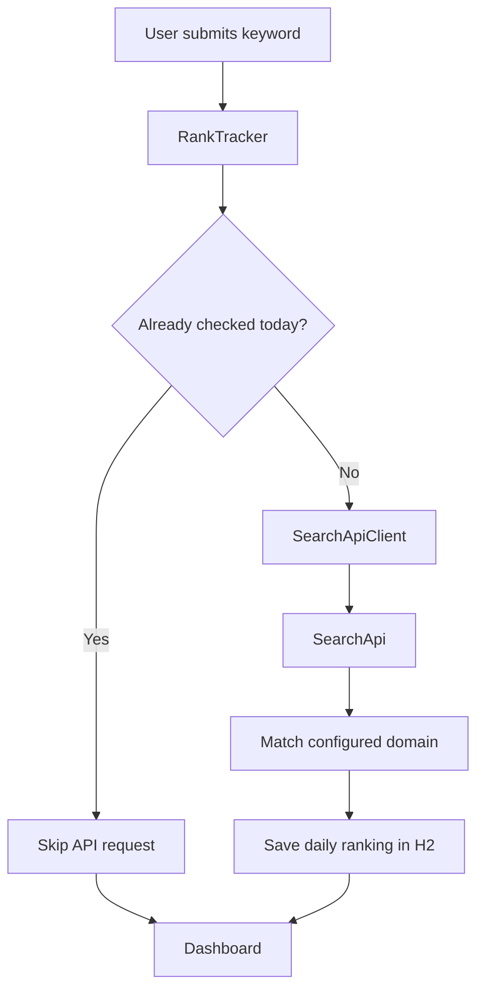

RankPulse
A Google keyword rank tracker built with Java 21 and Spring Boot.
RankPulse checks where a configured website appears in Google search results for selected keywords. It stores daily ranking snapshots and displays ranking changes and history in a web dashboard.
<p align="center">
  <em>Java 21 · Spring Boot · Spring JDBC · H2 · Thymeleaf · Chart.js · SearchApi</em>
</p>
---
Dashboard
<!-- Add your dashboard screenshot at docs/images/dashboard.png -->

Features
Track keywords: Submit a keyword and check its ranking immediately.
Google results lookup: Retrieve organic search results through SearchApi.
Domain matching: Find the configured domain in the returned results, including its subdomains.
Daily history: Save one ranking snapshot per keyword per date.
Duplicate-check protection: Skip another API request when that keyword has already been checked that day.
Ranking changes: Compare the latest result with the previous recorded result.
Alerts: Identify entry into the top 10, movement of at least five positions, and a drop out of the returned top 100.
History chart: Visualize recorded positions over time with Chart.js.
Scheduled checks: Check saved keywords at the configured time while the application is running.
Demo mode: Load sample history without making live SearchApi calls.
How it works
Enter a keyword on the dashboard.
The application checks whether the keyword has already been checked today.
If it has not, `SearchApiClient` requests Google organic results from SearchApi.
`RankTracker` looks for the configured domain in those results.
The application stores the matching position, or `NULL` if no match is returned.
The dashboard displays the latest position, movement, alerts, and recorded history.

Technology
Part	Technology
Language	Java 21
Framework	Spring Boot 4.1.3
Web	Spring MVC, Thymeleaf
External API client	Spring `RestClient`
Database access	Spring JDBC `JdbcClient`
Database	H2
Scheduling	Spring `@Scheduled`
Dashboard chart	Chart.js 4.4.1
Build	Maven Wrapper
Project structure
```text
ranktracker/
├── src/
│   ├── main/
│   │   ├── java/com/demo/ranktracker/
│   │   │   ├── RanktrackerApplication.java
│   │   │   ├── RankTracker.java
│   │   │   └── SearchApiClient.java
│   │   └── resources/
│   │       ├── static/css/style.css
│   │       ├── templates/dashboard.html
│   │       ├── application.properties
│   │       ├── application-demo.properties
│   │       ├── application-dev.properties
│   │       ├── schema.sql
│   │       └── demo-data.sql
│   └── test/
├── data/                 # Local H2 database files
├── mvnw
├── mvnw.cmd
└── pom.xml
```
Main components
File	Responsibility
`RanktrackerApplication.java`	Starts Spring Boot and enables scheduling.
`RankTracker.java`	Handles dashboard requests, ranking checks, database operations, scheduled checks, and ranking-change calculations.
`SearchApiClient.java`	Calls SearchApi and maps the organic search results.
`schema.sql`	Creates the ranking table.
`demo-data.sql`	Inserts sample ranking history for the demo profile.
`dashboard.html`	Renders the dashboard using Thymeleaf.
`style.css`	Styles the dashboard.
Database design
The application currently uses one table: `ranking`.
Column	Type	Description
`keyword`	`VARCHAR(255)`	Search keyword
`checked_on`	`DATE`	Date of the ranking check
`position`	`INT`, nullable	Position in the returned results; `NULL` if no match is found
The primary key is (`keyword`, `checked_on`).
This allows multiple daily records for the same keyword while preventing more than one record for the same keyword on the same date.
A missing match is stored as `NULL` and shown as `100+` in the dashboard. It means the configured domain was not found in the results returned by the API; it does not establish an exact position beyond 100.
Scheduling
The default schedule is configured in `application.properties`:
```properties
tracker.check-cron=0 0 6 * * *
```
This runs `checkAll()` at 6:00 AM in the machine's configured time zone, provided the application is running.
The same method also runs once when the application starts. It loads distinct keywords already present in the `ranking` table and checks them. The daily duplicate check prevents another API request for a keyword that already has a record for that date.
Note: This is an in-process scheduler. If the application is stopped at the scheduled time, the scheduled execution does not run while it is offline. The startup check provides another opportunity to check previously stored keywords when the application starts again.
Getting started
Requirements
JDK 21
Internet connection for live SearchApi requests
SearchApi account and API key for live ranking checks
Maven is included through the Maven Wrapper.
1. Clone the repository
```bash
git clone https://github.com/akashsonu0/rankpulse.git
cd rankpulse
```
2. Set the SearchApi key
The application reads the API key from the `SEARCH_API_KEY` environment variable.
Windows Command Prompt:
```bat
set SEARCH_API_KEY=your_searchapi_key
```
PowerShell:
```powershell
$env:SEARCH_API_KEY="your_searchapi_key"
```
Do not commit your real API key to the repository.
3. Run the application
Windows:
```bat
mvnw.cmd spring-boot:run
```
macOS / Linux:
```bash
./mvnw spring-boot:run
```
Open http://localhost:8080 in your browser.
Run from Eclipse
Import the project using File → Import → Maven → Existing Maven Projects.
Select the folder containing `pom.xml`.
Make sure the project JRE is set to JDK 21.
Open Run → Run Configurations and select the `RanktrackerApplication` launch configuration.
Under Environment, add `SEARCH_API_KEY` with your SearchApi key as its value.
Apply the configuration and run `RanktrackerApplication` as a Spring Boot application.
Open http://localhost:8080.
Application profiles
Profile	Command	Behaviour
Default	`mvnw.cmd spring-boot:run`	Uses the file-based H2 database and the daily 6:00 AM schedule.
Demo	`mvnw.cmd spring-boot:run -Dspring-boot.run.profiles=demo`	Uses an in-memory H2 database populated with sample history; scheduled checks are disabled.
Dev	`mvnw.cmd spring-boot:run -Dspring-boot.run.profiles=dev`	Runs the scheduled method every minute; the daily guard still skips keywords already checked today.
The demo records are sample data, not live Google rankings. The demo database is separate from the default file-based database.
The dev profile can make live API requests for keywords that have not yet been checked that day. Keep SearchApi credit usage in mind.
Useful Maven commands
Run these from the project root.
```bash
# Run tests
mvnw.cmd test

# Clean and build
mvnw.cmd clean package

# Run verification lifecycle
mvnw.cmd clean verify
```
On macOS/Linux, replace `mvnw.cmd` with `./mvnw`.
Current scope
This version is intentionally small and has the following boundaries:
It tracks one configured domain, set through `tracker.domain`.
It does not include user login, roles, or multi-user data separation.
It has no separate keyword table; scheduled keywords are read from existing ranking records.
If the first API request for a new keyword fails before a row is inserted, that keyword is not yet stored for future scheduled checks.
Scheduled execution depends on the application process being active.
The supplied code does not demonstrate a completed automated test suite or production deployment.
Possible improvements
Move ranking and alert logic into a dedicated service layer.
Add a keyword table so tracked keywords remain registered independently of ranking history.
Add unit and integration tests for domain matching, duplicate checks, API failures, and ranking changes.
Configure API timeouts and explicit handling for rate limits and provider errors.
Add multi-domain and multi-user support with authentication and authorization.
Use PostgreSQL or MySQL and database migrations for a deployed environment.
Add monitoring and a more reliable external or persistent job scheduler.
Resume description
RankPulse — Google Keyword Rank Tracker  
Java 21, Spring Boot, Spring JDBC, H2, Thymeleaf, Chart.js, SearchApi
Built a Spring Boot application that checks a configured website's Google keyword positions through SearchApi. Stored daily ranking snapshots in H2 using Spring JDBC, added duplicate-check protection with a composite primary key, automated checks with Spring Scheduling, and developed a Thymeleaf dashboard showing ranking changes, alerts, and historical trends.
---
Repository: github.com/akashsonu0/rankpulse
