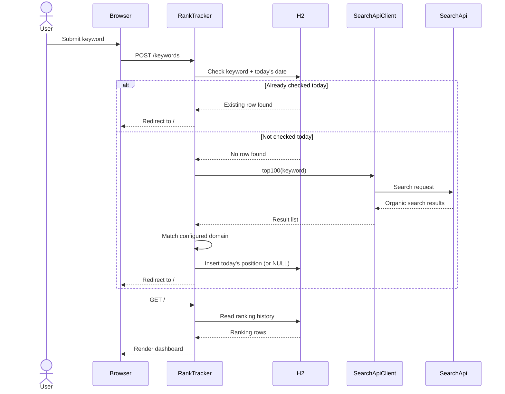

RankTracker --- Google Keyword Rank Monitoring
A Java 21 and Spring Boot application that checks where a configured
website appears in Google search results for selected keywords, stores
daily ranking snapshots, and presents ranking history in a dashboard.
> **Project status:** Working local application. The supplied
> implementation uses one configured domain, SearchApi for search data,
> JDBC with an H2 database, Thymeleaf for server-rendered pages, and
> Chart.js for the history chart.
---
Table of contents
Overview
Features
Dashboard
Technology stack
Architecture
How a ranking check works
Database design
Scheduling behaviour
Project structure
Prerequisites
Configuration
Run locally
Run with application profiles
Build and test
HTTP routes
Important implementation
decisions
Current scope and limitations
Potential next improvements
Resume description
Interview walkthrough
---
Overview
RankTracker automates a small but useful SEO workflow:
A user submits a search keyword from the dashboard.
The application requests Google ranking results from SearchApi.
It checks whether the configured website's domain appears in the
returned organic results.
It stores the discovered position, or `NULL` when the domain is not
found in the returned top 100.
The dashboard shows the latest position, movement from the previous
recorded check, alerts, and historical data.
The tracked website is configured through `tracker.domain`; it is not
entered separately for each keyword in the current version.
Features
Keyword submission: Add a keyword through the dashboard and
check it immediately.
External search integration: Calls SearchApi using Spring's
`RestClient`.
Domain matching: Matches the configured domain exactly or
matches its subdomains.
Daily snapshots: Stores a keyword's result by date.
Duplicate-check guard: Checks whether a keyword already has a
row for the current date before making another API request.
Ranking movement: Compares the latest stored position with the
previous stored position.
Alerts: Identifies entry into the top 10, a movement of at least
five positions, or a drop out of the returned top 100.
History chart: Uses Chart.js to display ranking values over
recorded dates.
Scheduled checks: Runs the daily check at the configured cron
time while the application is running.
Startup check: Checks keywords already present in the database
when the application starts.
Demo profile: Loads sample history into an in-memory H2 database
without using SearchApi for the demo schedule.
Dashboard
The dashboard is a server-rendered Thymeleaf page. It displays:
The configured domain.
A form to submit a keyword.
The latest position for each keyword (`100+` when the stored
position is `NULL`).
Position movement compared with the previous recorded snapshot.
Alerts for selected ranking changes.
A Chart.js line chart for historical positions.
The chart becomes more informative after multiple dates have been
recorded. A fresh database with only one date of data cannot show a
meaningful trend yet.
To add a screenshot to your GitHub repository, save the dashboard image
as `docs/images/dashboard.png` and add this Markdown where you want the
screenshot to appear:
``` md

```
Technology stack
Area                      Technology
---
Language                  Java 21
Application framework     Spring Boot 4.1.3
Web layer                 Spring MVC
Server-rendered UI        Thymeleaf
HTTP client               Spring `RestClient`
Database access           Spring JDBC `JdbcClient`
Local database            H2
Database initialization   `schema.sql` and Spring SQL initialization
Scheduling                Spring `@EnableScheduling` and `@Scheduled`
Frontend styling          CSS
Charting                  Chart.js 4.4.1
Build                     Maven / Maven Wrapper
---
Architecture
The current application is a compact, single-module Spring Boot
application. The controller currently coordinates the web requests,
ranking workflow, database reads/writes, and scheduled execution. The
external API integration is isolated in `SearchApiClient`.
High-level component diagram
``` mermaid
flowchart TB
    U[User / Browser]
    UI[Thymeleaf dashboard.html]
    C[RankTracker controller]
    S[SearchApiClient]
    API[SearchApi]
    DB[(H2 database)]
    JOB[Spring Scheduler]

    U -->|GET /| C
    U -->|POST /keywords| C
    C -->|Model attributes| UI
    UI -->|HTML response| U
    C -->|Ranking request| S
    S -->|HTTPS search request| API
    API -->|Organic results| S
    C -->|Read / write ranking snapshots| DB
    JOB -->|Calls checkAll()| C
    C -->|Read existing keywords| DB
```
Main responsibilities
---
Component                           Responsibility
---
`RanktrackerApplication`            Boots Spring Boot and enables
scheduled execution.
`RankTracker`                       Handles dashboard requests, keyword
submission, ranking checks,
database operations, movement
calculations, alerts, and scheduled
checks.
`SearchApiClient`                   Builds the SearchApi request, sends
it through `RestClient`, and maps
the response into Java records.
`application.properties`            Holds the configured domain,
database URL, API-key placeholder,
and default schedule.
`schema.sql`                        Creates the daily ranking table and
its composite primary key.
`dashboard.html`                    Renders the dashboard with
Thymeleaf and initializes the
Chart.js chart.
`style.css`                         Styles the dashboard.
Request and data flow

---
How a ranking check works
The main workflow is implemented by `RankTracker.check(String keyword)`.
Read the current date using `LocalDate.now()`.
Query `ranking` for the same keyword and date.
If a row already exists, log that the keyword was already checked
and stop. This avoids another SearchApi request for that keyword on
the same date.
Otherwise, call `SearchApiClient.top100(keyword)`.
Find the first returned result whose domain equals the configured
domain or ends with `.` plus the configured domain.
Store the result's position. If no matching result is found in the
returned results, store `NULL`.
Log the resulting position.
The dashboard displays a `NULL` position as `100+`. This means the
domain was not found in the result set returned by the configured
SearchApi request; it should not be interpreted as proof of the
website's exact ranking beyond position 100.
SearchApi request
`SearchApiClient` uses the endpoint:
``` text
https://www.searchapi.io/api/v1/search
```
It sends the `engine` and `q` query parameters, and reads the
`organic_results` response field. The API key is supplied through the
`Authorization` request header in the current implementation.
The exact request/response contract is owned by SearchApi. Check its
current documentation if its API format or authentication requirements
change.
---
Database design
The current schema contains one table.
`ranking`
---
Column                  Type                    Meaning
---
`keyword`               `VARCHAR(255)`          Search keyword being
tracked.
`checked_on`            `DATE`                  Date on which the
keyword was checked.
`position`              `INT`, nullable         Matched domain's
position; `NULL` when
not found in the
returned top 100.
Primary key: `(keyword, checked_on)`
The composite primary key represents the rule that the database stores
at most one snapshot for a keyword on a given date.
``` sql
CREATE TABLE IF NOT EXISTS ranking (
    keyword    VARCHAR(255) NOT NULL,
    checked_on DATE         NOT NULL,
    position   INT,
    PRIMARY KEY (keyword, checked_on)
);
```
Why use a composite primary key?
A keyword can have many historical snapshots, one for each date, but the
same keyword/date pair should not be inserted twice. The primary key
enforces that uniqueness at the database level. The application also
checks for an existing row before calling the external API, so it can
avoid spending an API credit on a repeated daily check.
The application-level check and database constraint serve different
purposes: the pre-check avoids unnecessary API calls in normal
sequential execution, while the primary key protects the stored data
from duplicate keyword/date rows.
---
Scheduling behaviour
Scheduling is enabled in `RanktrackerApplication` with
`@EnableScheduling`.
`RankTracker.checkAll()` has both:
`@EventListener(ApplicationReadyEvent.class)` --- runs once after
the application has started.
`@Scheduled(cron = "${tracker.check-cron}")` --- runs according to
the configured cron expression.
The method reads distinct keywords from the `ranking` table and calls
`check(keyword)` for each one. The daily duplicate-check guard means a
keyword already recorded for that date does not trigger another API
request.
Default schedule
``` properties
tracker.check-cron=0 0 6 * * *
```
This means 6:00 AM according to the machine/server's configured time
zone, while the application is running.
Important operational detail
This is an in-process scheduler, not a hosted job service. If the
computer is shut down or the application is not running at the scheduled
time, that scheduled execution does not run at that moment. When the
application starts again, the application-ready event invokes
`checkAll()` and checks the keywords already present in the database.
For a continuously available production scheduler, the application would
need to run on an always-on host or use an external scheduling
mechanism.
---
Project structure
The structure below reflects the files shown in the supplied project
screenshots and code.
``` text
ranktracker/
├── src/
│   ├── main/
│   │   ├── java/
│   │   │   └── com/demo/ranktracker/
│   │   │       ├── RanktrackerApplication.java
│   │   │       ├── RankTracker.java
│   │   │       └── SearchApiClient.java
│   │   └── resources/
│   │       ├── static/
│   │       │   └── css/
│   │       │       └── style.css
│   │       ├── templates/
│   │       │   └── dashboard.html
│   │       ├── application.properties
│   │       ├── application-demo.properties
│   │       ├── application-dev.properties
│   │       ├── schema.sql
│   │       └── demo-data.sql
│   └── test/
│       └── java/
├── data/                 # Local file-based H2 database (created at runtime)
├── mvnw
├── mvnw.cmd
└── pom.xml
```
The `data/` directory is runtime data, not source code. Do not commit
local database files unless there is a deliberate reason to share them.
---
Prerequisites
JDK 21.
Git, if cloning the repository.
Internet access for SearchApi requests.
A SearchApi account and API key for live ranking checks.
Maven is available through the included Maven Wrapper, so a separate
Maven installation is not required.
Configuration
1. Configure the API key
The application expects the environment variable `SEARCH_API_KEY`.
`application.properties` maps it into the Spring property:
``` properties
search.api-key=${SEARCH_API_KEY}
```
Do not place the real key in source code, commit it to Git, or paste it
into public issue trackers.
Eclipse
Open Run → Run Configurations.
Select the `RanktrackerApplication` Spring Boot run configuration.
Open Environment.
Add a variable:
Name: `SEARCH_API_KEY`
Value: your SearchApi API key
Select Apply, then Run.
Windows Command Prompt
``` bat
set SEARCH_API_KEY=your_actual_api_key
mvnw.cmd spring-boot:run
```
The `set` command applies to that terminal session. Use a secure local
environment-variable mechanism for persistent development setup.
2. Application properties
The supplied default configuration is:
``` properties
spring.application.name=ranktracker

search.api-key=${SEARCH_API_KEY}
tracker.domain=embarkx.com

spring.datasource.url=jdbc:h2:file:./data/rank-tracker
spring.sql.init.mode=always

tracker.check-cron=0 0 6 * * *
```
`tracker.domain` selects the website whose search result domain is
matched.
`spring.datasource.url` uses a file-based H2 database under the
application's working directory.
`spring.sql.init.mode=always` enables SQL initialization from the
configured schema/data scripts.
`tracker.check-cron` controls the scheduled check time.
Change `tracker.domain` to the domain you want to monitor. The current
dashboard tracks one configured domain at a time.
---
Run locally
Option A: Eclipse
Import the folder containing `pom.xml` as an Existing Maven
Project.
Confirm the project uses JDK 21.
Add `SEARCH_API_KEY` to the `RanktrackerApplication` run
configuration as described above.
Right-click `RanktrackerApplication.java`.
Select Run As → Spring Boot App.
Open `http://localhost:8080`.
Option B: Windows terminal
From the directory containing `pom.xml`:
``` bat
set SEARCH_API_KEY=your_actual_api_key
mvnw.cmd spring-boot:run
```
Open:
``` text
http://localhost:8080
```
The first run may download Maven dependencies. Keep the application
process running while using the dashboard and while expecting scheduled
checks.
---
Run with application profiles
The project includes separate profile files for normal operation, demo
data, and schedule testing.
Default profile
``` bat
mvnw.cmd spring-boot:run
```
Uses the file-based H2 database and the default 6:00 AM schedule. A
valid API key is required when a live SearchApi request is made.
Demo profile
``` bat
mvnw.cmd spring-boot:run -Dspring-boot.run.profiles=demo
```
The supplied `application-demo.properties` configures an in-memory H2
database, loads `demo-data.sql`, and sets the cron expression to `-` to
disable the scheduled task. The demo SQL inserts sample ranking history
for demonstrating the dashboard, chart, and alert presentation.
The demo data is illustrative, not live Google ranking data. The
in-memory database is separate from the default file-based database.
Development scheduling profile
``` bat
mvnw.cmd spring-boot:run -Dspring-boot.run.profiles=dev
```
The supplied `application-dev.properties` changes the cron expression
to:
``` properties
tracker.check-cron=0 * * * * *
```
This runs the scheduled method every minute. The daily duplicate-check
guard still prevents repeated API calls for a keyword that already has a
row for the current date. Use this profile carefully because newly
eligible keywords can consume API credits.
---
Build and test
Run the Maven build from the directory containing `pom.xml`:
``` bat
mvnw.cmd clean verify
```
To create the application JAR:
``` bat
mvnw.cmd clean package
```
To run the existing automated tests:
``` bat
mvnw.cmd test
```
The supplied material shows the test source directory but does not
include test classes or test results. Do not describe automated test
coverage as complete until tests have been added and run.
---
HTTP routes
---
Method                  Route                   Purpose
---
`GET`                   `/`                     Reads ranking history
and renders the
dashboard.
`POST`                  `/keywords`             Accepts a keyword,
checks it immediately,
and redirects to the
dashboard.
The current UI is a server-rendered web application; a separate public
REST API for managing keywords or retrieving ranking history is not
implemented in the supplied code.
---
Important implementation decisions
1. Store a daily snapshot rather than overwriting the latest value
Keeping a row per keyword/date allows the dashboard to compare positions
over time. Updating one row in place would lose the previous value
needed for movement and chart history.
2. Avoid repeat API calls for the same keyword/date
The application checks the database before calling SearchApi. The
composite primary key also enforces uniqueness for a keyword/date pair.
3. Store `NULL` when no matching result is returned
A missing match is different from a known numeric position. `NULL`
preserves that distinction in the database, while the UI presents it as
`100+`.
4. Keep the API integration in its own component
`SearchApiClient` isolates request construction and response mapping
from the controller's ranking workflow. This makes the external
integration easier to replace or test independently.
5. Use profiles for safe demonstrations
The demo profile uses a separate in-memory database and sample SQL data.
This lets someone review the dashboard without confusing sample history
with live results or changing the normal file-based database.
---
Current scope and limitations
This section is intentional: it distinguishes what the supplied code
implements from capabilities that would require more engineering.
Single configured domain: `tracker.domain` is one application
property. The current UI does not let users manage multiple
websites.
No user accounts or tenant isolation: Authentication,
authorization, and per-user data ownership are not implemented.
Keyword persistence is history-driven: There is no separate
`keyword` table. `checkAll()` discovers keywords using
`SELECT DISTINCT keyword FROM ranking`.
A failed first check is not saved as a tracked keyword: The
keyword is inserted only after the API request and result processing
succeed. If the first request fails, it will not be available to
`checkAll()` from the database until a successful check creates a
row.
Local scheduler: Scheduled execution depends on the application
process being active. Startup checking provides a catch-up attempt
for keywords already stored, but this is not a durable distributed
job queue.
No demonstrated automated test suite: Tests should be added for
domain matching, duplicate prevention, ranking movement, alerts, and
API error handling.
No production deployment or monitoring shown: The supplied
implementation is a local application and should not be described as
production-hosted.
External API dependency: Live checks require SearchApi
availability, a valid API key, network access, and sufficient
account credits.
No explicit retry/backoff policy: API timeouts, rate limits, and
transient failures need a deliberate resilience strategy before
production use.
Concurrency needs further protection: The pre-check followed by
insert is a check-then-act sequence. Concurrent checks for the same
keyword/date can still race; the database primary key will reject a
duplicate insert, but the workflow does not currently coordinate
concurrent workers.
---
Potential next improvements
A sensible engineering roadmap would be:
Introduce a service layer: Move ranking orchestration,
persistence, movement calculations, and alert rules out of
`RankTracker` into focused services.
Add a keyword table: Persist tracked keywords independently of
ranking history so a keyword remains registered even when an API
request fails.
Add automated tests: Test domain/subdomain matching, missing
results, duplicate daily checks, ranking changes, alerts, and
controller behaviour.
Harden API integration: Configure connection/read timeouts,
handle provider errors explicitly, and add bounded retries/backoff
where appropriate.
Improve scheduling reliability: Use a persistent job scheduler
or external scheduler for deployments where missed runs must be
recovered reliably.
Add multi-domain support: Model websites and tracked keywords
separately, with ownership and authorization.
Move to a production database: Use PostgreSQL or MySQL with
schema migrations when deploying beyond local development.
Add observability: Structured logs, health checks, metrics, and
alerting for failed scheduled runs and API quota usage.
Improve dashboard usability: Add date filters, keyword status,
loading/error states, and clearer handling of missing ranking data.
Deploy and document operations: Add deployment instructions,
environment configuration, backup strategy, and operational
monitoring.
---
Resume description
RankTracker | Java 21, Spring Boot, Spring JDBC, H2, Thymeleaf,
Chart.js, SearchApi
Built a Spring Boot web application that tracks a configured website's
Google keyword positions using SearchApi. Implemented daily ranking
snapshots with JDBC and H2, duplicate-check prevention using a composite
database key, scheduled checks, ranking movement/alert calculations, and
a Thymeleaf dashboard with historical Chart.js visualization.
Only include performance metrics, scale, deployment, test coverage, or
production claims on your resume if you have measured or implemented
them.
Interview walkthrough
A concise way to explain the project:
> "I built a keyword rank-tracking application using Java and Spring
> Boot. A user submits a keyword, and the application calls SearchApi to
> retrieve Google organic results. I compare the returned result domains
> with a configured website domain and store the matching position as a
> daily snapshot in H2 using Spring JDBC. A composite primary key
> prevents duplicate records for the same keyword and date, and an
> application-level check avoids unnecessary API calls. I also added
> scheduled checks and a Thymeleaf dashboard that shows the latest
> position, ranking movement, alerts, and historical trends using
> Chart.js."
Be ready to explain these design questions:
Why store daily snapshots instead of updating one current-position
row?
What does the composite primary key protect?
Why does a missing result become `NULL` instead of `0`?
What happens if the application is stopped at the scheduled time?
Why is the API key stored in an environment variable?
What would you change to support multiple users and multiple
domains?
How would you test the duplicate-check and alert logic?
How would you handle API timeouts, rate limits, and concurrent
scheduled runs?
---
Note: This README documents the implementation and files shared for
review. Update it whenever the code, configuration, dependencies, or
supported features change.
