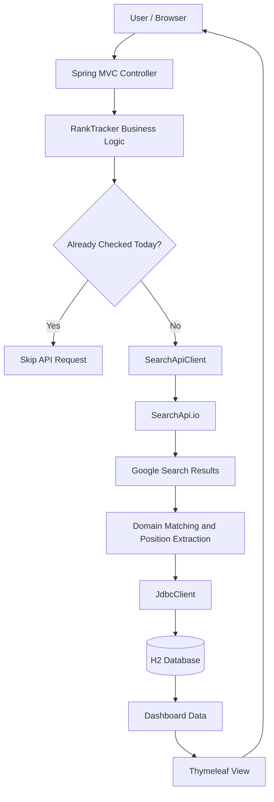

# RankTracker – Google Keyword Rank Tracking System

A lightweight Google Keyword Rank Tracking application built using **Java 21 and Spring Boot**. It allows users to track how a website ranks on Google for specific keywords, store daily ranking history, monitor position changes, and visualize ranking trends through a dashboard.

The application integrates with [SearchApi.io](https://www.searchapi.io/) to retrieve Google search results and identify the position of a configured website.

---

## Table of Contents

- [Overview](#overview)
- [Features](#features)
- [Application Architecture](#application-architecture)
- [Technology Stack](#technology-stack)
- [Project Structure](#project-structure)
- [How It Works](#how-it-works)
- [Database Design](#database-design)
- [Duplicate Prevention Strategy](#duplicate-prevention-strategy)
- [Scheduled Ranking Checks](#scheduled-ranking-checks)
- [Ranking Change and Alert Logic](#ranking-change-and-alert-logic)
- [External API Integration](#external-api-integration)
- [Configuration](#configuration)
- [Getting Started](#getting-started)
- [Running the Application](#running-the-application)
- [Application Profiles](#application-profiles)
- [API Endpoints](#api-endpoints)
- [Future Improvements](#future-improvements)

---

## Overview

RankTracker helps monitor a website's visibility in Google search results for different keywords.

For example, suppose a website wants to monitor its Google ranking for:

- spring boot tutorial
- microservices
- java programming
- springboot

Instead of manually searching Google every day, RankTracker automatically fetches search results through SearchApi, identifies the configured domain, and stores its ranking position.

The application maintains historical ranking data and provides a dashboard to monitor changes over time.

**Example:**

| Keyword | Current Position | Meaning |
|---|---:|---|
| spring boot tutorial embarkx | #2 | Ranked second |
| microservices | 100+ | Not found in top 100 |
| springboot | 100+ | Not found in top 100 |

The application also identifies significant ranking changes and generates alerts.

---

## Features

### 1. Google Keyword Rank Tracking
- Track multiple search keywords for a configured website.
- Fetch Google search results using SearchApi.io.
- Identify the matching website domain.
- Extract the website's ranking position from search results.
- Represent missing rankings as `100+`.

### 2. Daily Ranking History
- Store keyword ranking positions in an H2 database.
- Maintain historical records for each day.
- Compare current rankings with previous rankings.
- Preserve previous ranking data instead of overwriting it.

### 3. Duplicate API Call Prevention
- Check whether a keyword has already been tracked on the current date.
- Prevent unnecessary SearchApi requests.
- Use a composite database primary key to enforce daily uniqueness.

### 4. Automated Ranking Checks
- Execute scheduled ranking checks using Spring's scheduling support.
- Automatically check previously tracked keywords when the application starts.
- Run daily checks at the configured time.

### 5. Ranking Change Detection
- Detect upward and downward ranking movements.
- Identify keywords entering the top 10.
- Detect keywords dropping out of the top 100.
- Generate alerts for significant position changes.

### 6. Dashboard and Visualization
- Display current keyword positions.
- Show ranking movements.
- Display alerts for significant changes.
- Visualize historical ranking trends using Chart.js.

---

## Application Architecture

The application follows a layered, component-based Spring architecture. The controller coordinates business operations, the API client handles external communication, and JdbcClient manages database interactions.

### High-Level Architecture



### Component Responsibilities

| Component | Responsibility |
|---|---|
| RanktrackerApplication | Starts Spring Boot and enables scheduling |
| RankTracker | Contains keyword tracking and ranking business logic |
| SearchApiClient | Communicates with the external SearchApi service |
| JdbcClient | Executes SQL queries and database operations |
| H2 Database | Stores ranking history |
| Thymeleaf | Renders the dashboard |
| Chart.js | Visualizes ranking history |

### Application Execution Flow

**Step 1: User submits a keyword**

The user enters a keyword through the dashboard form.

**Step 2: Controller receives the request**

The `/keywords` POST endpoint receives the keyword and calls the `check()` method.

**Step 3: Duplicate verification**

Before making an external API request, the application checks whether the keyword has already been checked today.

**Step 4: External API request**

If the keyword has not been checked, `SearchApiClient` fetches Google ranking results.

**Step 5: Domain matching**

The application searches the returned results for the configured domain and extracts its position.

**Step 6: Database persistence**

The keyword, ranking position, and current date are stored in the database.

**Step 7: Dashboard rendering**

The dashboard retrieves ranking history, calculates changes and alerts, and displays the results.

---

## Technology Stack

| Technology | Purpose |
|---|---|
| Java 21 | Programming language |
| Spring Boot 4.1.3 | Application framework and auto-configuration |
| Spring MVC | HTTP request handling |
| Spring JdbcClient | Database interaction |
| H2 Database | Embedded relational database |
| Spring Scheduling | Automated daily checks |
| Spring Thymeleaf | Server-side HTML rendering |
| SearchApi.io | Google search result retrieval |
| Chart.js | Ranking history visualization |
| Maven | Dependency management and build automation |
| SLF4J | Application logging |
| CSS | Dashboard styling |

---

## Project Structure

```text
ranktracker/
│
├── src/
│   ├── main/
│   │   ├── java/
│   │   │   └── com/demo/ranktracker/
│   │   │       │
│   │   │       ├── RanktrackerApplication.java
│   │   │       ├── RankTracker.java
│   │   │       └── SearchApiClient.java
│   │   │
│   │   └── resources/
│   │       │
│   │       ├── static/
│   │       │   └── css/
│   │       │       └── style.css
│   │       │
│   │       ├── templates/
│   │       │   └── dashboard.html
│   │       │
│   │       ├── application.properties
│   │       ├── application-demo.properties
│   │       ├── application-dev.properties
│   │       ├── schema.sql
│   │       └── demo-data.sql
│   │
│   └── test/
│       └── java/
│
├── data/
│   └── rank-tracker.mv.db
│
├── target/
├── mvnw
├── mvnw.cmd
└── pom.xml
```

### Main Java Components

**1. RanktrackerApplication.java**

Application entry point.

Responsibilities:
- Starts the Spring Boot application.
- Enables scheduled task execution using `@EnableScheduling`.
- Initializes the application context.

**2. RankTracker.java**

Main business logic component.

Responsibilities:
- Accepts keywords for tracking.
- Checks for existing daily records.
- Calls SearchApiClient.
- Identifies the configured domain's position.
- Saves ranking history.
- Calculates ranking changes and alerts.
- Provides dashboard data.
- Executes scheduled ranking checks.

**3. SearchApiClient.java**

External API integration component.

Responsibilities:
- Configures Spring RestClient.
- Sends requests to SearchApi.io.
- Retrieves Google ranking results.
- Maps the API response into Java records.
- Returns organic search results to RankTracker.

---

## Database Design

The application uses an H2 file-based database to maintain ranking history.

### Ranking Table

```sql
CREATE TABLE IF NOT EXISTS ranking (
    keyword    VARCHAR(255) NOT NULL,
    checked_on DATE         NOT NULL,
    position   INT,

    PRIMARY KEY (keyword, checked_on)
);
```

### Column Description

| Column | Data Type | Description |
|---|---|---|
| keyword | VARCHAR(255) | Search keyword |
| checked_on | DATE | Date of ranking check |
| position | INT | Google ranking position |

**Composite Primary Key:**

The combination of `keyword` and `checked_on` forms the primary key.

This ensures that the same keyword cannot have multiple records for the same date.

The `position` column allows NULL values to represent keywords that were not found in the top 100 results.

### Database Example

| keyword | checked_on | position |
|---|---|---:|
| spring boot tutorial | 2026-11-19 | 8 |
| spring boot tutorial | 2026-11-20 | 2 |
| microservices | 2026-11-20 | NULL |

This structure allows the application to preserve historical ranking records.

---

## Duplicate Prevention Strategy

One important part of this application is avoiding unnecessary external API requests.

SearchApi requests consume API credits, so repeatedly checking the same keyword on the same day should be avoided.

The application uses two levels of duplicate prevention.

**1. Application-level verification**

Before making an API call, the application executes:

```sql
SELECT COUNT(*)
FROM ranking
WHERE keyword = ?
AND checked_on = ?
```

If a record exists, the API request is skipped.

**2. Database-level protection**

The composite primary key:

```sql
PRIMARY KEY (keyword, checked_on)
```

Prevents duplicate records at the database level.

This approach reduces unnecessary API usage and maintains daily data consistency.

---

## Scheduled Ranking Checks

The application uses Spring's `@Scheduled` annotation to automate ranking checks.

Default configuration:

```properties
tracker.check-cron=0 0 6 * * *
```

This schedules the task to execute daily at 6:00 AM in the application's local timezone.

The scheduled method retrieves all previously tracked keywords:

```java
@Scheduled(cron = "${tracker.check-cron}")
@EventListener(ApplicationReadyEvent.class)
public void checkAll() {

    for (String keyword :
            db.sql("SELECT DISTINCT keyword FROM ranking")
              .query(String.class).list()) {

        try {
            check(keyword);
        } catch (Exception e) {
            System.err.println(
                "Error checking keyword "
                + keyword + ": " + e.getMessage()
            );
        }
    }
}
```

The method also runs once when the application starts because of `@EventListener(ApplicationReadyEvent.class)`.

The daily duplicate check prevents repeated API calls for keywords already checked on that date.

**Important:** Scheduled checks run only while the application is running. If the machine is switched off or the application is stopped, scheduled executions will not occur during that time.

---

## Ranking Change and Alert Logic

The application compares the latest ranking with the previous recorded ranking.

### Ranking Movement

- If the new position is lower numerically, the website has moved up.
- If the new position is higher numerically, the website has moved down.
- If both positions are equal, there is no change.
- If the position is NULL, the website is outside the top 100 or was not returned in the results.

### Alert Conditions

| Condition | Generated Alert |
|---|---|
| Previous position greater than 10 and current position 10 or better | Entered the top 10 |
| Previous position exists and current position is NULL | Dropped out of the top 100 |
| Absolute position change is at least 5 | Significant ranking movement |
| Change is less than 5 positions | No significant alert |

Example:

```text
Previous position: #16
Current position:  #8

Alert: Entered the top 10 (#16 → #8)
```

Another example:

```text
Previous position: #9
Current position:  #15

Alert: Moved down 6 places (#9 → #15)
```

The dashboard displays these alerts alongside current keyword positions.

---

## External API Integration

The application integrates with SearchApi.io to retrieve Google search results.

The integration uses Spring's `RestClient`.

API endpoint:

```text
https://www.searchapi.io/api/v1/search
```

The request includes:

| Parameter | Purpose |
|---|---|
| engine | Google rank tracking search engine |
| q | Search keyword |

The application processes the returned organic results and identifies the configured website domain.

The API key is supplied through an environment variable instead of being hardcoded.

---

## Configuration

Application configuration is maintained in `application.properties`.

```properties
spring.application.name=ranktracker

search.api-key=${SEARCH_API_KEY}

tracker.domain=embarkx.com

spring.datasource.url=jdbc:h2:file:./data/rank-tracker

spring.sql.init.mode=always

tracker.check-cron=0 0 6 * * *
```

### Environment Variables

The application requires the following environment variable:

| Variable | Description |
|---|---|
| SEARCH_API_KEY | SearchApi.io API key |

**Windows PowerShell:**

```powershell
$env:SEARCH_API_KEY="your_actual_api_key"
```

**Windows Command Prompt:**

```cmd
set SEARCH_API_KEY=your_actual_api_key
```

**Eclipse IDE:**

1. Open Run Configurations.
2. Select RanktrackerApplication.
3. Open the Environment tab.
4. Add `SEARCH_API_KEY`.
5. Paste your actual API key as its value.
6. Apply and run.

Never commit actual API keys to GitHub.

---

## Getting Started

### Prerequisites

Make sure you have:

- Java 21 or later.
- Maven or the included Maven Wrapper.
- Eclipse IDE or another Java IDE.
- SearchApi.io account and API key.

### 1. Clone the Repository

```bash
git clone YOUR_GITHUB_REPOSITORY_URL
```

### 2. Navigate to the Project

```bash
cd ranktracker
```

### 3. Configure API Key

Set the `SEARCH_API_KEY` environment variable before starting the application.

### 4. Build the Project

On Windows:

```cmd
mvnw.cmd clean install
```

### 5. Run the Application

```cmd
mvnw.cmd spring-boot:run
```

Alternatively, run `RanktrackerApplication.java` directly from Eclipse.

### 6. Open the Dashboard

```text
http://localhost:8080
```

Enter a keyword and click Track to fetch its ranking.

---

## Running the Application

### Default Profile

Uses the file-based H2 database and daily scheduled checks.

```cmd
mvnw.cmd spring-boot:run
```

### Demo Profile

The demo profile uses an in-memory H2 database with predefined sample ranking history.

```cmd
mvnw.cmd spring-boot:run -Dspring-boot.run.profiles=demo
```

The demo dataset demonstrates:
- A keyword entering the top 10.
- A keyword moving down six positions.
- A keyword dropping out of the top 100.
- Small ranking improvements.

The demo profile disables the scheduled task.

**Note:** The current SearchApiClient requires the `SEARCH_API_KEY` property at application startup, including when using the demo profile.

### Development Profile

The development profile runs the scheduled check every minute.

```cmd
mvnw.cmd spring-boot:run -Dspring-boot.run.profiles=dev
```

The daily duplicate prevention logic still applies, so the first eligible check can make an API request while subsequent checks for that keyword on the same date are skipped.

---

## API Endpoints

| Method | Endpoint | Description |
|---|---|---|
| GET | `/` | Displays the ranking dashboard |
| POST | `/keywords` | Adds and immediately checks a keyword |

The application uses Thymeleaf form submission and redirects back to the dashboard after keyword submission.

---

## Future Improvements

Potential improvements for extending this project:

- Support tracking multiple websites.
- Add user registration and authentication.
- Introduce separate user and keyword management.
- Migrate from H2 to PostgreSQL or MySQL for production deployment.
- Add REST APIs for external clients.
- Introduce pagination for large ranking histories.
- Add retry handling and API rate-limit management.
- Improve domain normalization and keyword validation.
- Add automated unit and integration tests.
- Deploy the application using Docker and AWS.
- Add notifications through email when significant ranking changes occur.
- Introduce a background job system for reliable scheduled execution.

---

## Key Engineering Concepts Demonstrated

This project demonstrates practical implementation of:

- Spring Boot application configuration.
- Dependency Injection and constructor-based injection.
- Spring MVC request handling.
- Spring RestClient for external API communication.
- Spring JdbcClient and SQL operations.
- Relational database design and composite primary keys.
- Scheduled tasks using `@Scheduled`.
- Application lifecycle events using `ApplicationReadyEvent`.
- Business logic for ranking comparison.
- Exception handling and logging.
- Server-side rendering with Thymeleaf.
- Data visualization using Chart.js.
- External API integration and environment-based configuration.

---

**Project:** RankTracker – Google Keyword Rank Tracking System

**Built with:** Java 21 | Spring Boot | H2 | SearchApi.io | Thymeleaf | Chart.js | Maven

